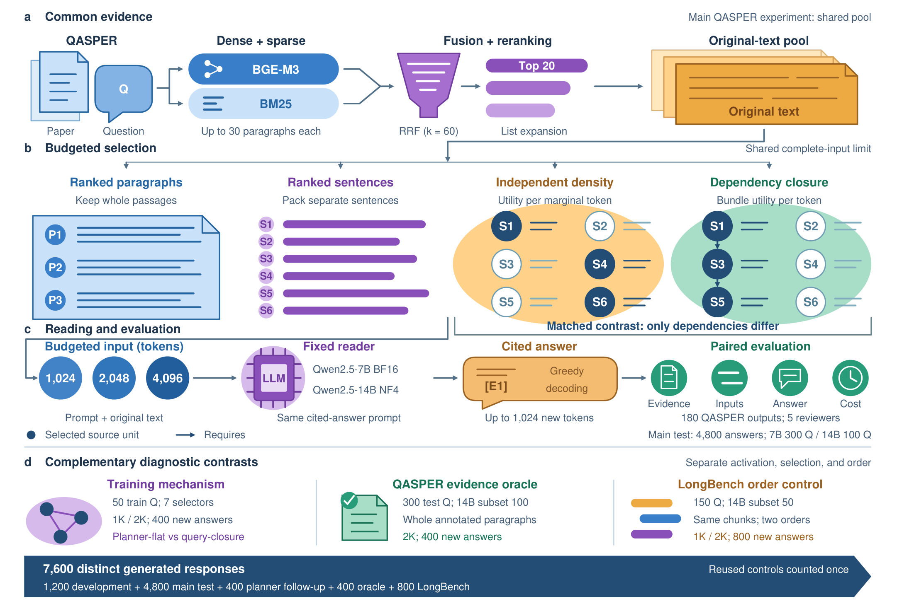

# TrustRAG-paper

Code and de-identified study materials for **Evidence Preservation, Answer Sufficiency, and Cost in Budgeted Scientific Question Answering**.

This paper-only export contains no previous Git history, deployment settings, credentials, model weights, or reviewer background information. It does not publish the unpublished manuscript itself.

## Study and principal findings

The study separates three interventions: preserving source dependencies, choosing sufficient evidence, and reordering an unchanged evidence set. Retrieval scores and the generator prompt are matched in the main dependency comparison. Input budgets include the prompt and chat template, not just source text.

| Stage | Scope | Response records |
| --- | --- | ---: |
| Initial QASPER development | 50 train questions; four selectors, three budgets, two deployments | 1,200 |
| Main QASPER official-test comparison | 300 questions for 7B; prespecified 100-question 14B subset | 4,800 |
| Question-conditioned planning follow-up | Same 50 train questions; seven selectors and two budgets | 700: 400 new, 300 reused |
| Whole-paragraph human-evidence oracle | QASPER 2K; 300 questions for 7B, 100 for 14B | 1,200: 400 new, 800 reused |
| Independent MultiFieldQA-en order control | 150 questions for 7B, official first 50 for 14B; two budgets | 800 new |
| Blinded human assessment | Five independent reviewers, 180 outputs each | 900 ratings; 42 source adjudications |

There are **7,600 distinct generated responses**, not 7,600 independent questions. Abstentions, errors, limit rejections and planning failures remain in the records.

| Comparison | Result |
| --- | --- |
| QASPER 7B full-paragraph recall, 1K | Density 0.278 → closure 0.502; Answer F1 change +0.19 points |
| QASPER 7B full-paragraph recall, 2K | Density 0.576 → closure 0.729; Answer F1 change −0.03 points |
| Human joint success, 7B 2K, 60 pairs | Closure 37/60 vs density 34/60; +5.00 pp, 95% interval [−3.39, 13.56] |
| QASPER 7B 2K evidence oracle | Closure F1 26.90 → oracle 38.11; +11.20 points [8.69, 13.78] |
| QASPER 14B NF4 2K evidence oracle | Closure F1 32.00 → oracle 45.28; +13.28 points [9.07, 17.42] |
| Independent LongBench ordering | All four paired deployment–budget intervals contain zero |
| Planner dependency ablation | Identical selected inputs and raw outputs in both budgets |

Answer F1 is a lexical overlap measure, not human accuracy. Human joint success additionally requires relevance, correctness, completeness, citation support and no unsupported additions. The 7B BF16 and 14B NF4 conditions are deployment comparisons with a quantization difference. The oracle is a post hoc diagnostic, not a deployable selector.



## Contents

| Location | Contents |
| --- | --- |
| `src/trustrag/` | Retrieval, original-text selectors, fixed reader prompts, scoring, statistics and blind-review tools |
| `scripts/` | Snapshot download, material restoration, serial experiment runners |
| `materials/index.json` | Every exported material and its restored repository-relative location |
| `materials/qasper/` | Samples, source coordinates, complete inputs, raw predictions, outcomes, plans and stage summaries |
| `materials/qasper/test_v1/human_review_v2/` | Anonymous ratings, adjudications, completed case mapping, rubric packet and final analysis |
| `materials/longbench/multifieldqa_en/` | Ordered example IDs, selected-chunk coordinates, raw predictions and paired summary |
| `research/v2/figures/` | Three editable SVGs, vector PDFs, previews and rendering scripts |

Compressed JSON/JSONL files preserve the recorded predictions and judgments. Administrative machine paths, GPU indices, reviewer backgrounds and timestamps were removed. The method map is released after completion of the blind assessment; it is not a credential. AI-persona rehearsal records are not included.

For strict de-identification, email addresses and social-media handles appearing inside redistributed QASPER source slices or model outputs are replaced with neutral placeholders. These substitutions do not change questions, ratings, answer scores or source coordinates. The exact public source text remains available from the official QASPER release.

### Data attribution

QASPER-derived texts and references originate from Dasigi et al., *A Dataset of Information-Seeking Questions and Answers Anchored in Research Papers*, NAACL 2021 ([paper](https://aclanthology.org/2021.naacl-main.365/), [official dataset card](https://huggingface.co/datasets/allenai/qasper)). QASPER is distributed under [CC BY 4.0](https://creativecommons.org/licenses/by/4.0/); this release selects examples and source slices and adds study predictions and measurements. It omits the original annotation-worker metadata.

MultiFieldQA-en originates from Bai et al., *LongBench: A Bilingual, Multitask Benchmark for Long Context Understanding*, ACL 2024 ([paper](https://aclanthology.org/2024.acl-long.172/), [official dataset](https://huggingface.co/datasets/zai-org/LongBench)). LongBench documents, questions and references are not redistributed here: restore them from the authors' `data.zip`. Model weights retain their upstream licences and are downloaded separately.

## Inspect results without a GPU

Python 3.11 is used for the research environment. Material restoration uses only the Python standard library:

```bash
python scripts/restore_materials.py
```

This expands the published records to `data/research/v2/` and recreates the source-linked review page. It does not run generation or overwrite existing records. View each stage's `results/comparison.json`, and the completed human `human_review_v2/analysis.json`.

To restore LongBench input text as well:

```bash
python scripts/restore_materials.py --longbench-archive /path/to/official/data.zip
```

The official example order must match the released IDs. Saved chunk coordinates reconstruct exactly the selected source slices and prompt order; no retrieval is repeated.

The five human review exports contain `reviewer_01` through `reviewer_05` only. To independently recompute the final human analysis, without loading models:

```bash
PYTHONPATH=src python -m trustrag.qasper_review_analysis \
  data/research/v2/qasper/test_v1/human_review_v2/review.html \
  --key data/research/v2/qasper/test_v1/human_review_v2/private_key.json \
  --review data/research/v2/qasper/test_v1/human_review_v2/reviews/reviewer_01.json \
  --review data/research/v2/qasper/test_v1/human_review_v2/reviews/reviewer_02.json \
  --review data/research/v2/qasper/test_v1/human_review_v2/reviews/reviewer_03.json \
  --review data/research/v2/qasper/test_v1/human_review_v2/reviews/reviewer_04.json \
  --review data/research/v2/qasper/test_v1/human_review_v2/reviews/reviewer_05.json \
  --provenance-confirmation data/research/v2/qasper/test_v1/human_review_v2/provenance_confirmation.json \
  --adjudication data/research/v2/qasper/test_v1/human_review_v2/adjudication.json \
  --adjudication-confirmation data/research/v2/qasper/test_v1/human_review_v2/adjudication_confirmation.json \
  --output data/research/v2/qasper/test_v1/human_review_v2/recomputed_analysis.json
```

The frozen study plan required at least two independent reviewers; the completed assessment expanded this to five reviewers without changing the fixed cases, rubric, blinded ordering or primary endpoint.

Pairs are matched by question, method, budget and deployment. Automatic intervals use 5,000 paper/document-cluster bootstrap draws, seed 42. Raw failures contribute to the full denominator. Reused controls in the follow-up and oracle stages are not additional independent generations.

## Rerun experiments in a separate clean checkout

Do not restore completed predictions into the checkout used for a new inference run: runners deliberately skip already recorded outputs.

```bash
python3.11 -m venv .venv
source .venv/bin/activate
python -m pip install -e '.[research,dev,figures]'
python scripts/download_models.py --root "$PWD"
```

| Role | Fixed identifier | Revision |
| --- | --- | --- |
| Encoder | BAAI/bge-m3 | 5617a9f61b028005a4858fdac845db406aefb181 |
| QASPER reranker | BAAI/bge-reranker-v2-m3 | 953dc6f6f85a1b2dbfca4c34a2796e7dde08d41e |
| Primary reader and train planner | Qwen/Qwen2.5-7B-Instruct | a09a35458c702b33eeacc393d103063234e8bc28 |
| Secondary reader, NF4 | Qwen/Qwen2.5-14B-Instruct | cf98f3b3bbb457ad9e2bb7baf9a0125b6b88caa8 |

Download the [official train/dev archive](https://qasper-dataset.s3.us-west-2.amazonaws.com/qasper-train-dev-v0.3.tgz) and [official test archive](https://qasper-dataset.s3.us-west-2.amazonaws.com/qasper-test-and-evaluator-v0.3.tgz) into `data/research/v2/qasper/raw/`. Prepare the seeded samples:

```bash
python -m trustrag.qasper_pilot prepare \
  data/research/v2/qasper/raw/qasper-train-dev-v0.3.tgz \
  --split train --limit 50 --output data/research/v2/qasper/pilot/dataset.json
python -m trustrag.qasper_study \
  data/research/v2/qasper/raw/qasper-test-and-evaluator-v0.3.tgz \
  --output data/research/v2/qasper/test_v1/dataset.json
```

For the initial train matrix, use the train sample and `development_v1/results` in the same retrieve/budget/generate sequence below. The main official-test sequence is:

```bash
python -m trustrag.qasper_pilot retrieve \
  data/research/v2/qasper/test_v1/dataset.json \
  --output data/research/v2/qasper/test_v1/results/retrieval.jsonl --root "$PWD" --gpu 0
python -m trustrag.qasper_pilot budget \
  data/research/v2/qasper/test_v1/dataset.json \
  --retrieval data/research/v2/qasper/test_v1/results/retrieval.jsonl \
  --tokenizer-dir cache/huggingface/hub/models--Qwen--Qwen2.5-7B-Instruct/snapshots/a09a35458c702b33eeacc393d103063234e8bc28 \
  --budgets 1024 2048 4096 --output data/research/v2/qasper/test_v1/results
python scripts/run_research_development.py --root "$PWD" \
  --dataset data/research/v2/qasper/test_v1/dataset.json \
  --results data/research/v2/qasper/test_v1/results
python -m trustrag.research_statistics data/research/v2/qasper/test_v1/dataset.json \
  --results data/research/v2/qasper/test_v1/results
```

After completing the initial train and test matrices, `scripts/run_research_followup.py` runs the train-only mechanism follow-up. Place the official LongBench archive at `data/research/v2/longbench/raw/data.zip`, then `scripts/run_research_supplement.py` runs the oracle and matched ordering validation. Generation is serial on one idle RTX 4090, with four numerical threads. The reader prompts and selection rules are included in the source; no finetuning or test-result-based prompt changes are applied.

The planning study was an implementation-iterated training follow-up: saved parser failures are retained. A new run with the final parser is a rerun of that implementation, not a reconstruction of the early historical failure distribution. Use the archived records for the reported training diagnostic.

For a new human assessment, `python -m trustrag.qasper_review --help` gives the packet-builder interface. Send only the generated blinded page to real reviewers, retaining its method mapping with the coordinator. Published completed ratings are not labels for newly generated answers.

## Reuse notice

See [`NOTICE.md`](NOTICE.md) for third-party attribution, de-identification details and the current reuse status. This public research snapshot does not include a separate open-source licence for the authors' original code or study records.

## Figures and focused tests

```bash
python research/v2/figures/render_results.py --root .
python -m pytest -q
```

Figure 3 reads restored summaries; it does not recalculate statistics or generate answers. The SVG and PDF outputs retain editable/vector content. Figures 1 and 2 describe the matched interventions, while Figure 3 shows the observed activation, oracle and ordering results.
